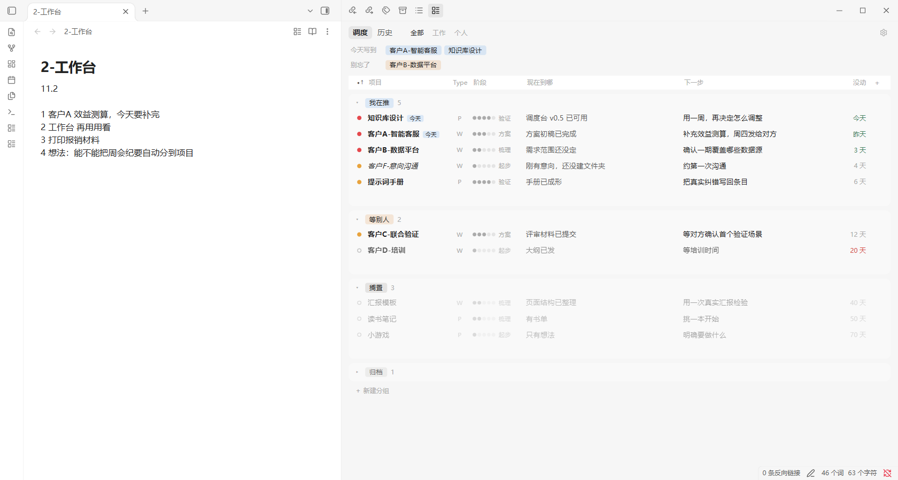
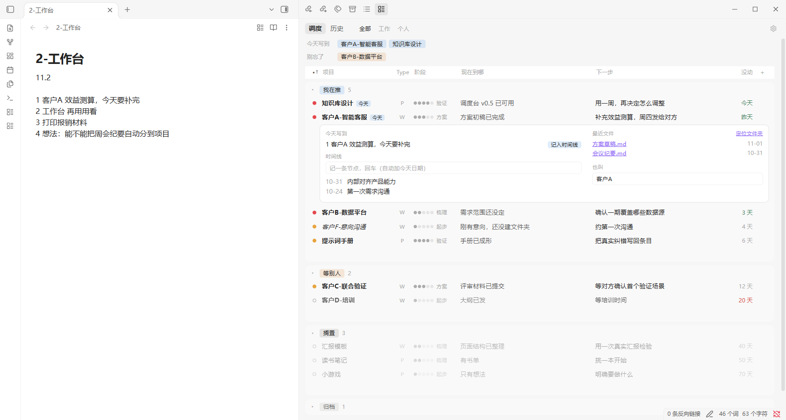
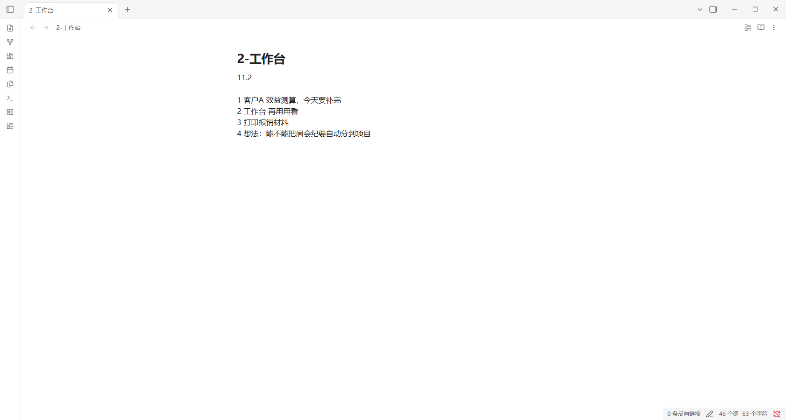
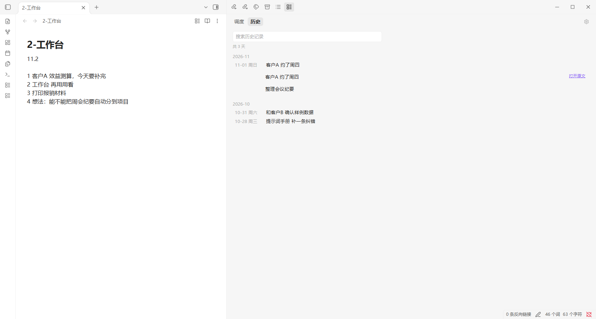

# 调度台 Dispatch Board

一个 Obsidian 插件：把“今天写什么”和“所有项目到哪了”放在同一个窗口里。

主区域是今天的工作台笔记，右侧抽屉是调度台。文件夹自动变成项目，久没动的项目自动变灰沉底，每天自动翻篇。



> 这是我自己工作流的**公开参考**，不是通用产品。路径写死在代码里，只在 Obsidian 1.14.5（Windows 桌面版）上测过，也用到了 Obsidian 的非公开接口。想直接用，需要先按下面的说明改路径。

截图和示例数据都是虚构的。

## 它解决什么问题

一个人同时推很多事时，常见的情况是：

- 记录散在各处，第二天接不上；
- 看板要专门维护，几周后就没人更新，变成半成品；
- 重要的事没写进今天的清单，就真的忘了。

这个插件的取舍是：**你只管写今天和拖一拖，能自动的都自动。**

| 动作 | 谁来做 |
|---|---|
| 写今天的内容 | 你，用原生编辑器，没有格式要求 |
| 文件夹变成项目 | 自动 |
| 项目多久没动、变灰沉底 | 自动，取文件修改时间 |
| 今天写到的项目亮起，重要但没写到的提醒 | 自动，按项目名和别名匹配文字 |
| 过了今天的内容进历史 | 自动 |
| 换状态、改下一步、记节点 | 你，在表格里当场改 |
| 整理进展、补时间线 | AI 可以直接改同一个 JSON，页面实时刷新 |

## 主要功能

**今天**
- 工作台就是一篇普通笔记，粘图、双链、其他编辑器插件都正常。
- 过了今天自动翻篇，按月存档，可按天查看和搜索。今天的内容不会被翻走。

**调度**
- 一键滑出、收回右侧抽屉。
- 一个项目一行，按分组归类；拖行换分组或调顺序，数字键快速移动。
- 列、分组、阶段、重要程度都能在表格里当场改：点表头改名、换类型、编辑选项、排序、隐藏、插入；拖表头调顺序和宽度。
- 可以加文字、选项、日期列；日期到了会提醒。

**连接今天和项目**
- 写到项目名或别名，项目自动标“今天”。
- 重要但今天没写到的，列进顶部“别忘了”。
- 点“记入时间线”，或把工作台里选中的文字拖到项目上，同步进展。

**变灰**
- 14 天没动变淡，30 天没动变灰沉底（可调）；一有动静自动恢复，也可以设为常亮。



| 收起抽屉，只留今天 | 历史 |
|---|---|
|  |  |

## 试用

用虚构数据生成一个演示库，不碰你自己的笔记：

```bash
python examples/make_demo_vault.py ./demo-vault
mkdir -p demo-vault/.obsidian/plugins/dispatch-board
cp main.js manifest.json styles.css demo-vault/.obsidian/plugins/dispatch-board/
```

用 Obsidian 打开 `demo-vault`，在“第三方插件”里启用“调度台”，再点左侧的列表图标。

**用在自己的库：** 修改 `main.js` 开头的 `STORE_PATH`、`BENCH_PATH`、`HISTORY_DIR`，以及 `DEFAULT_STORE` 里的扫描目录。

## 文档

- [架构](docs/ARCHITECTURE.md)：模块划分、数据模型、关键流程和安全约束
- [设计决策](docs/DESIGN-DECISIONS.md)：为什么这样做，以及试过又放弃的方案
- [工作流规范](docs/WORKFLOW.md)：文件夹约定，以及 AI 怎么参与

## 现状和局限

- 路径写死，没有做成可配置的通用插件。
- 关联是文字匹配，不理解语义；没写到名称或别名就关联不上。
- 用到了非公开接口（侧栏尺寸、设置页跳转、文件列表定位），Obsidian 升级后可能失效。
- 只在 Windows 桌面版 1.14.5 上测过。开发时用真实鼠标键盘跑过端到端测试，但测试依赖私有数据，没有放进仓库。

## 协议

[MIT](LICENSE)
