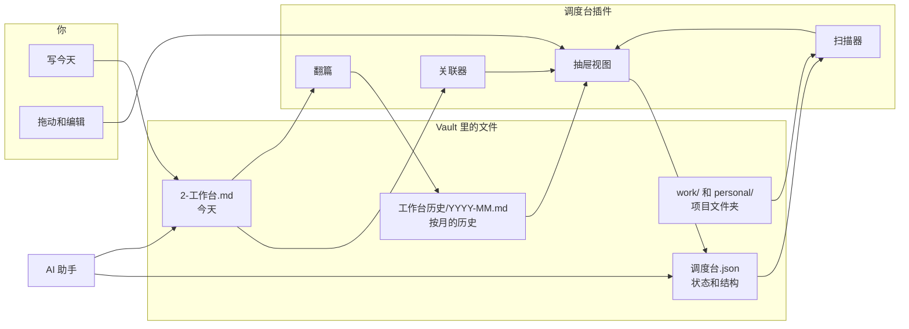
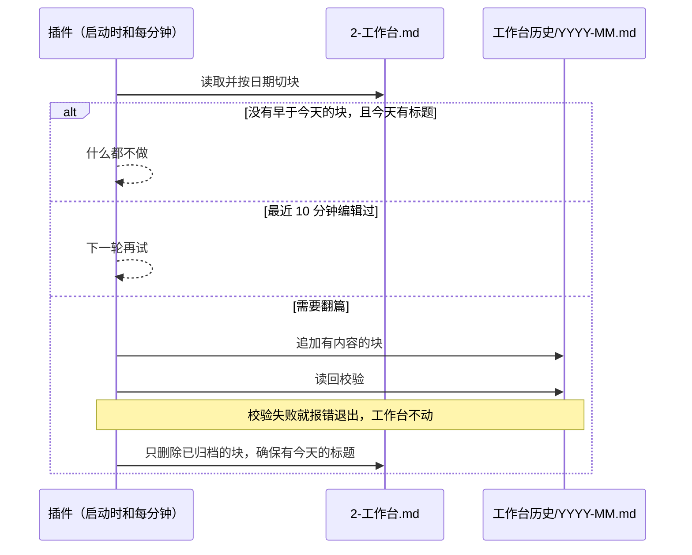

# 架构

## 一句话

**文件夹是项目的来源，一个 JSON 是状态的来源，一篇笔记是今天的来源。** 插件只负责把这三者接起来并呈现出来，不复制内容。



## 界面分层

Obsidian 的原生区域各司其职，插件只占右侧栏的一个标签。

| 位置 | 内容 | 由谁渲染 |
|---|---|---|
| 主区域 | `2-工作台.md`，今天 | Obsidian 原生编辑器 |
| 右侧抽屉 | 调度台：今天写到 / 别忘了、分组表格、历史页 | 插件的 `ItemView` |
| 工作台标题栏 | 拉出 / 收起按钮 | 插件，`view.addAction` |
| 设置页 | 提醒天数、扫描范围、恢复默认 | 插件的 `PluginSettingTab` |

抽屉的滑动动效用的是 Obsidian 右侧栏自带的动画。

## 代码结构

全部在 `main.js`，没有构建步骤。

| 部分 | 职责 |
|---|---|
| 常量和默认值 | 路径、默认列、默认分组 |
| `splitDays` / `headingDay` | 把文本按日期标题切块，切块能精确拼回原文 |
| `DispatchView` | 抽屉视图：页头、今天写到 / 别忘了、表格、弹出菜单、行内编辑、拖拽、展开详情、历史页 |
| `DispatchSettings` | 很少改动的设置 |
| `DispatchBoardPlugin` | 生命周期、抽屉开合、读写状态、扫描项目、关联、翻篇、结构编辑 |

## 数据模型

所有状态在一个文件 `1.1-主任务/调度台.json`：

```jsonc
{
  "version": 1,
  "roots":   [{ "path": "1.1-主任务/work", "line": "工作" }],   // 下一级文件夹就是项目
  "archive": ["1.1-主任务/work/归档"],                           // 它的下一级默认进归档分组
  "ignore":  ["1.1-主任务/work/会议纪要"],                       // 不算项目，也记录被隐藏的项目
  "config":  { /* 列、分组、阶段、重要程度、提醒天数、排序；没有时用代码默认值 */ },
  "projects": {
    "1.1-主任务/work/客户A": {            // 键是文件夹路径
      "lane": "我在推",                   // 分组
      "level": "高",                      // 重要程度
      "stage": "方案",                    // 阶段
      "node": "现在到哪",
      "next": "下一步",
      "alias": "客户A，A 公司",           // 工作台写到这些词就关联
      "fields": { "下次跟进": "2026-11-10" },  // 用户自建的列
      "log": [{ "d": "2026-11-02", "t": "发生了什么" }],  // 时间线，推算的日期前加 ~
      "touched": "2026-11-02",            // 最近一次明确的动静
      "keep": true,                       // 常亮，不随时间变灰
      "order": 3,                         // 手动排序时的位置
      "virtual": true                     // 还没有文件夹的项目
    }
  }
}
```

**什么存 JSON，什么不存：**

| 信息 | 来源 | 原因 |
|---|---|---|
| 有哪些项目 | 扫描文件夹 | 建文件夹就够了，不用维护第二份清单 |
| 最近文件、文件时间 | 实时读取 | 永远真实，不会过期 |
| 状态、下一步、时间线 | JSON | 文件夹表达不了 |
| 今天写到哪些项目 | 实时匹配工作台 | 是计算结果，不落盘 |

一个项目计算后的字段：

- `days`：最新文件修改时间和 `touched` 取较新的一个，距今多少天。
- `fade`：0 正常，1 变淡（超过 `staleDays`），2 变灰沉底（超过 `fadeDays`，或没有任何记录）；`keep` 恒为 0。
- `mentions`：工作台里提到它的行。

## 关键流程

### 翻篇



规则：

- 早于今天的才会翻，今天的永远留着，也没有手动翻篇。
- 只有“先写入并校验历史”成功，才会修改工作台。
- 修改工作台时按原文块逐个删除；如果块在这期间变了，就保留不删，宁可重复，不会丢失。
- 空白的日子不进历史。
- 标题只认“前一行为空”的 `11.2` 或 `2026-11-02`，代码块里的不算；没有年份的日期默认今年，超过未来 60 天的算去年。

### 关联今天和项目

工作台保存时（防抖 500 毫秒）重新读取，逐行匹配项目名和别名，不区分大小写。只有匹配结果变化才重绘，所以写无关内容时调度台不会刷新。这里没有用模型，结果可预期，也不需要联网。

### 状态写入和热更新

- 页面操作先改内存，再整体写回 JSON。
- 外部修改（比如 AI 改了文件）触发 `modify` 事件；内容和插件最后写入的不一样时重新载入。
- JSON 解析失败时不载入、不覆盖，并提示检查文件，页面保持上次的状态。

### 改名

结构编辑都带着数据走：分组、阶段、级别、选项、自建列改名时，同步更新所有项目里的值。文件夹在任何地方被改名或移动，`projects` 的键也跟着改；移入归档文件夹时自动进归档分组。

### 抽屉开合

- 切换时判断：侧栏展开、且当前标签就是调度台，才收起；否则切到调度台并展开。
- 第一次拉出约占窗口 62%，最大 1180 像素；窗口太小时收窄，给写作区留空间。之后保留用户拖出来的宽度。
- 旧版本留在主区域的调度台标签，会自动搬进抽屉。
- 查找工作台时要兼容 Obsidian 的延迟加载：后台标签的 `view.file` 还不存在，要读 `getViewState()`。

## 安全约束

改代码时不能破坏这些：

1. 今天的内容不会被自动移走。
2. 工作台的内容，在写入并校验历史之前不删除。
3. 数据文件损坏时不覆盖。
4. 插件不删除、不移动项目文件夹；只有用户显式新建或重命名时才动文件夹。“隐藏”只是写入 `ignore`。
5. 删除分组或自建列不丢项目数据。

## 用到的非公开接口

升级 Obsidian 后，优先检查这些：

| 接口 | 用途 |
|---|---|
| `workspace.rightSplit.setSize / size / collapsed` | 抽屉尺寸和状态 |
| `leaf.parent.currentTab` | 判断抽屉当前标签 |
| `app.setting.open / openTabById` | 跳到设置页 |
| `app.internalPlugins.getEnabledPluginById('file-explorer')` | 在文件列表中定位 |

## 还没做的

- 路径可配置，变成通用插件。
- 没做完的事带到明天。
- 用时间线画项目线（节点、分支）。
- AI 定期处理工作台和历史，自动起草进展。
