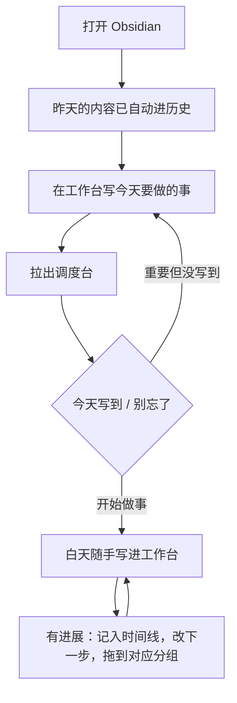

# 工作流规范

插件之外的约定：文件放哪，每天怎么过，AI 怎么参与。

## 目录

保持简单。文件夹只表达“这是什么”，状态交给调度台。

```text
0-assets/                 图片和附件
1.1-主任务/
  work/<项目>/            每个文件夹就是一个项目
  work/归档/<项目>/       结束的工作项目
  personal/<项目>/
  调度台.json             所有项目的状态
1.3-已归档/work/工作台历史/
  YYYY-MM.md              每天翻篇进这里
2-工作台.md               只放今天
3-待办清单.md             不属于任何项目的杂事
4-method-方法资产/        验证过、能复用的方法
```

项目文件夹内部：

- 根目录放当前有效的判断、方案和成果。
- `过程/` 放会议记录、对话、调研和历史版本，可以不完整。

## 一天怎么过



- **工作台没有格式要求。** 日期单独一行（如 `11.2`），下面随便写。
- **分组的含义是“球在谁手里”**，不是工作类型：我在推、等别人、搁置、归档。可以按自己的习惯改。
- **一周看一次灰色的项目**，决定捡起、继续放着，还是归档。

## 内容去向

| 内容 | 去哪 |
|---|---|
| 当天的想法和工作 | `2-工作台.md` |
| 项目状态、节点、下一步 | `调度台.json`（在调度台里改） |
| 已形成的判断、方案和成果 | 项目根目录 |
| 过程材料 | 项目的 `过程/` |
| 不属于项目的待办 | `3-待办清单.md` |
| 没有长期价值的闲聊 | 留在工作台，随翻篇进历史 |

## AI 怎么参与

### 可以直接做

- 读工作台和最近的历史，判断内容属于哪个项目。
- 把过程材料和成果存进对应项目。
- 更新 `调度台.json` 的 `lane`、`level`、`stage`、`node`、`next`、`fields`、`touched`、`log`、`alias`。
- 能合理判断的直接填，不留“待确认”占位；错了由人校准。

### 不能做

- 把没有依据的事写成已发生（拜访、发送、客户回应）。
- 改 `config`，除非人明确要求。列和分组是人的结构。
- 手动移动工作台内容。翻篇由插件完成。
- 在内容保存到别处之前，删除或覆盖原文。

### 写 JSON 的要求

- 键是项目文件夹路径；还没有文件夹的事项，键写计划路径并加 `"virtual": true`。
- 日期用 `YYYY-MM-DD`；时间线里推算的日期前面加 `~`。
- `node` 和 `next` 都是一句话，20 字左右，否则一行放不下。
- 保持合法 JSON，写坏了页面不会更新（也不会覆盖文件）。

### 让 AI 读到这份规范

规范放在库里一个固定文件中，并让工具启动时自动读取（比如根目录的 `AGENTS.md` 或 `CLAUDE.md`）。否则它只有在你提醒时才会遵守。
